# Entity Relationship Diagram & Relational Schema Design

## 1. Relational Architecture & ER Diagram

The following diagram defines the entity relationships, cardinalities, primary keys, and foreign keys across all core entities and supporting audit ledgers.

```mermaid
erDiagram
    APPLICANTS ||--o{ EMPLOYMENTS : "has (1:N)"
    APPLICANTS ||--o{ INCOME_RECORDS : "has (1:N)"
    APPLICANTS ||--o{ CREDIT_FACILITIES : "holds (1:N)"
    APPLICANTS ||--o{ CREDIT_PROFILES : "evaluated_in (1:N)"
    APPLICANTS ||--o{ LOAN_APPLICATIONS : "applies_for (1:N)"
    LOAN_PRODUCTS ||--o{ LOAN_APPLICATIONS : "governs (1:N)"
    
    LOAN_APPLICATIONS ||--o{ DOCUMENTS : "requires (1:N)"
    LOAN_APPLICATIONS ||--o{ AFFORDABILITY_CHECKS : "assessed_by (1:N)"
    LOAN_APPLICATIONS ||--o{ DECISIONS : "decided_by (1:N)"
    LOAN_APPLICATIONS ||--o{ REPAYMENT_SCHEDULES : "amortized_in (1:N)"
    LOAN_APPLICATIONS ||--o| DISBURSEMENTS : "disbursed_to (1:1)"
    
    LOAN_APPLICATIONS ||--o{ APPLICATION_STATUS_HISTORY : "tracks (1:N)"
    DOCUMENTS ||--o{ DOCUMENT_VERIFICATION_HISTORY : "audits (1:N)"
    DECISIONS ||--o{ DECISION_RULE_EXECUTIONS : "logs (1:N)"
    DECISIONS ||--o{ DECISION_OVERRIDE_HISTORY : "overridden_by (1:N)"
    DISBURSEMENTS ||--o{ DISBURSEMENT_EVENTS : "progresses (1:N)"
    
    EMPLOYMENTS ||--o{ INCOME_RECORDS : "validates (0..1:N)"

    APPLICANTS {
        string applicant_id PK "APP-2026-XXXXXX"
        string first_name
        string last_name
        date date_of_birth
        string email UK
        string phone
        string city
        string state
        string postal_code
        string applicant_status
        int credit_score
        timestamp created_at
    }

    EMPLOYMENTS {
        string employment_id PK "EMP-2026-XXXXXX"
        string applicant_id FK
        string employer_name
        string employment_type
        string industry
        string job_title
        date employment_start_date
        date employment_end_date
        decimal monthly_salary
        string employment_status
        string verification_status
    }

    INCOME_RECORDS {
        string income_record_id PK "INC-2026-XXXXXX"
        string applicant_id FK
        string employment_id FK "Nullable"
        string income_source
        decimal gross_monthly_income
        decimal net_monthly_income
        decimal additional_income
        date income_period_start
        date income_period_end
        string verification_status
        string source_reference
    }

    CREDIT_FACILITIES {
        string credit_facility_id PK "FAC-2026-XXXXXX"
        string applicant_id FK
        string facility_type
        string lender_reference
        decimal credit_limit
        decimal outstanding_balance
        decimal monthly_emi
        decimal interest_rate
        string payment_status
        date opened_date
        date closed_date
    }

    CREDIT_PROFILES {
        string credit_profile_id PK "CP-2026-XXXXXX"
        string applicant_id FK
        int synthetic_credit_score
        string score_band
        decimal payment_history
        decimal credit_utilization
        int active_facility_count
        date assessment_date
        string score_version
        string source_type
    }

    LOAN_PRODUCTS {
        string product_id PK "PROD-001..004"
        string product_name
        string product_type
        decimal min_principal
        decimal max_principal
        int min_term_months
        int max_term_months
        decimal annual_interest_rate
        decimal processing_fee_rate
        decimal maximum_dti
        decimal maximum_foir
        int minimum_credit_score
        string product_status
        date effective_from
        date effective_to
    }

    LOAN_APPLICATIONS {
        string application_id PK "LOAN-2026-XXXXXX"
        string applicant_id FK
        string product_id FK
        decimal requested_principal
        int requested_term_months
        timestamp application_date
        string application_status
        string submission_channel
        int application_version
    }

    DOCUMENTS {
        string document_id PK "DOC-LOAN-...-XXX"
        string application_id FK
        string document_type
        string submission_status
        string verification_status
        timestamp submitted_at
        timestamp verified_at
        date expiry_date
        string rejection_reason
        string document_reference
    }

    AFFORDABILITY_CHECKS {
        string affordability_check_id PK "AFF-LOAN-...-XX"
        string application_id FK
        timestamp assessment_timestamp
        decimal monthly_net_income
        decimal existing_monthly_debt
        decimal proposed_monthly_emi
        decimal debt_to_income_ratio
        decimal fixed_obligation_ratio
        decimal disposable_income
        string affordability_status
        string rule_version
        string calculation_details
    }

    DECISIONS {
        string decision_id PK "DEC-LOAN-...-XX"
        string application_id FK
        int decision_sequence
        string decision_status
        timestamp decision_timestamp
        string decision_reason_code
        string decision_explanation
        int risk_score
        string rules_triggered
        string reviewer_id
        string rule_version
    }

    REPAYMENT_SCHEDULES {
        string schedule_id PK "SCH-LOAN-...-XXX"
        string application_id FK
        int installment_number
        date due_date
        decimal opening_balance
        decimal principal_amount
        decimal interest_amount
        decimal installment_amount
        decimal closing_balance
        string payment_status
        decimal paid_amount
        date paid_date
    }

    DISBURSEMENTS {
        string disbursement_id PK "DISB-LOAN-..."
        string application_id FK "UNIQUE"
        decimal disbursed_amount
        date disbursement_date
        string disbursement_status
        string bank_reference
        timestamp created_at
    }

    APPLICATION_STATUS_HISTORY {
        string history_id PK
        string application_id FK
        string previous_status
        string new_status
        timestamp changed_at
        string changed_by
        string notes
    }

    DOCUMENT_VERIFICATION_HISTORY {
        string history_id PK
        string document_id FK
        string previous_status
        string new_status
        timestamp verified_at
        string verified_by
        string reason
    }

    DECISION_RULE_EXECUTIONS {
        string execution_id PK
        string decision_id FK
        string rule_id
        string rule_version
        string evaluated_values
        boolean is_triggered
        string triggered_action
    }

    DECISION_OVERRIDE_HISTORY {
        string override_id PK
        string decision_id FK
        string application_id FK
        string previous_status
        string overridden_status
        string underwriter_id
        string override_reason
        timestamp overridden_at
    }

    DISBURSEMENT_EVENTS {
        string event_id PK
        string disbursement_id FK
        string event_type
        timestamp event_timestamp
        string event_payload
    }
```

---

## 2. Cardinality Analysis & Foreign Key Rules

| Relationship | Parent Entity | Child Entity | Cardinality | FK Column | Cascade / Action | Business Justification |
|:---|:---|:---|:---|:---|:---|:---|
| **R1** | `Applicant` | `Employment` | 1:N | `applicant_id` | `RESTRICT` | Applicants may have multiple sequential jobs or concurrent freelance roles. |
| **R2** | `Applicant` | `IncomeRecord` | 1:N | `applicant_id` | `RESTRICT` | Multiple verified income records (primary salary, rental, business). |
| **R3** | `Employment` | `IncomeRecord` | 0..1:N | `employment_id` | `SET NULL` | Income streams tied to a specific salaried role; optional for non-employment income. |
| **R4** | `Applicant` | `CreditFacility` | 1:N | `applicant_id` | `RESTRICT` | Borrowers can possess multiple credit cards, mortgages, or personal loans. |
| **R5** | `Applicant` | `LoanApplication` | 1:N | `applicant_id` | `RESTRICT` | Applicants may submit multiple applications over time (or sequential repeat loans). |
| **R6** | `LoanProduct` | `LoanApplication` | 1:N | `product_id` | `RESTRICT` | Products govern lending parameters (rates, tenure limits, DTI thresholds). |
| **R7** | `LoanApplication` | `Document` | 1:N | `application_id` | `CASCADE` | Each application requires mandatory proof documents (PAN, KYC, Payslip). |
| **R8** | `LoanApplication` | `AffordabilityCheck`| 1:N | `application_id` | `CASCADE` | Affordability checks run on application updates; maintains versioned assessments. |
| **R9** | `LoanApplication` | `Decision` | 1:N | `application_id` | `CASCADE` | Decisions maintain an immutable historical sequence (`decision_sequence` >= 1). |
| **R10** | `LoanApplication` | `RepaymentSchedule` | 1:N | `application_id` | `CASCADE` | Amortization installments (1 through `requested_term_months`). |
| **R11** | `LoanApplication` | `Disbursement` | 1:1 | `application_id` | `RESTRICT` | `UNIQUE` constraint guarantees no duplicate successful loan disbursement. |
| **R12** | `LoanApplication` | `AppStatusHistory` | 1:N | `application_id` | `CASCADE` | Audit ledger tracking all status changes. |
| **R13** | `Document` | `DocVerifHistory` | 1:N | `document_id` | `CASCADE` | History of document reviews, approvals, and rejections. |
| **R14** | `Decision` | `RuleExecution` | 1:N | `decision_id` | `CASCADE` | Granular per-rule evaluation outcomes for transparent explainability. |
| **R15** | `Disbursement` | `DisburseEvent` | 1:N | `disbursement_id`| `CASCADE` | Milestone event tracking for payment lifecycles. |
| **R16** | `Applicant` | `CreditProfile` | 1:N | `applicant_id` | `CASCADE` | Grounded historical bureau credit snapshots and score tracking. |
| **R17** | `Decision` | `DecisionOverrideHistory` | 1:N | `decision_id` | `CASCADE` | Regulatory compliance audit trail for human underwriter overrides. |

---

## 3. Database Indexes for High-Performance Queries

To guarantee millisecond queries across 10,000 applicants and 6,000 applications:

1. `CREATE INDEX idx_applicant_email ON applicants(email);`
2. `CREATE INDEX idx_employment_applicant ON employments(applicant_id);`
3. `CREATE INDEX idx_income_applicant ON income_records(applicant_id);`
4. `CREATE INDEX idx_facilities_applicant ON credit_facilities(applicant_id);`
5. `CREATE INDEX idx_credit_profiles_applicant ON credit_profiles(applicant_id);`
6. `CREATE INDEX idx_applications_applicant ON loan_applications(applicant_id);`
7. `CREATE INDEX idx_applications_product ON loan_applications(product_id);`
8. `CREATE INDEX idx_applications_status ON loan_applications(application_status);`
9. `CREATE INDEX idx_documents_application ON documents(application_id);`
10. `CREATE INDEX idx_affordability_app ON affordability_checks(application_id);`
11. `CREATE INDEX idx_decisions_app ON decisions(application_id);`
12. `CREATE INDEX idx_override_decision ON decision_override_history(decision_id);`
13. `CREATE INDEX idx_schedules_app ON repayment_schedules(application_id, installment_number);`
14. `CREATE UNIQUE INDEX idx_disbursement_unique_app ON disbursements(application_id) WHERE disbursement_status = 'DISBURSED';`
3. `CREATE INDEX idx_income_applicant ON income_records(applicant_id);`
4. `CREATE INDEX idx_facilities_applicant ON credit_facilities(applicant_id);`
5. `CREATE INDEX idx_applications_applicant ON loan_applications(applicant_id);`
6. `CREATE INDEX idx_applications_product ON loan_applications(product_id);`
7. `CREATE INDEX idx_applications_status ON loan_applications(application_status);`
8. `CREATE INDEX idx_documents_application ON documents(application_id);`
9. `CREATE INDEX idx_affordability_app ON affordability_checks(application_id);`
10. `CREATE INDEX idx_decisions_app ON decisions(application_id);`
11. `CREATE INDEX idx_schedules_app ON repayment_schedules(application_id, installment_number);`
12. `CREATE UNIQUE INDEX idx_disbursement_unique_app ON disbursements(application_id) WHERE disbursement_status = 'DISBURSED';`

